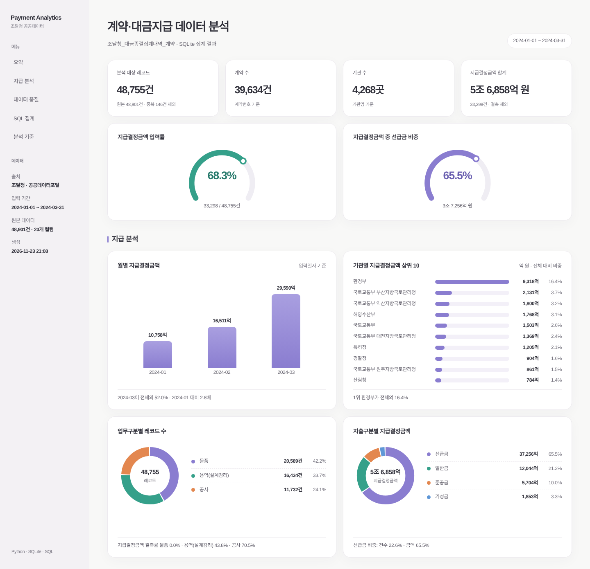

# Public-PaymentDB-Manager

**공공 계약·대금지급 데이터 기반 SQLite 데이터베이스 구축 및 SQL 분석 프로젝트**

조달청이 공개한 계약·대금지급 데이터 **48,901건**을 SQLite 데이터베이스로 구축하고, SQL 분석 결과를 그래프와 HTML 대시보드로 시각화한 Python 프로젝트입니다. CSV 품질 검증부터 DB 적재, 조건 검색, SQL 집계, 보고서 생성까지 전체 과정을 구현했으며, 실제 데이터에서 발견한 중복·결측·식별번호 손상 문제에 원본 보존과 집계 정확성을 고려한 처리 기준을 적용했습니다.

| 항목 | 내용 |
|---|---|
| 데이터 | 조달청_대금종결집계내역_계약 (48,901건 × 23개 컬럼) |
| 기술 스택 | Python, SQLite, SQL, pandas, Matplotlib, pytest |
| 주요 기능 | 데이터 품질 검증, DB 적재, 조건 검색, SQL 집계, 시각화 |
| 결과물 | CLI 프로그램, SQLite DB, SQL 집계 8종, 그래프 4종, HTML 대시보드 |
| 테스트 | pytest 47개 통과 (실제 데이터 통합 테스트 포함) |



## 주요 성과

- **데이터 품질 관리:** 원본 48,901건에서 완전 중복 146건을 식별하고, 분석 대상 48,755건을 별도로 관리
- **데이터 손상 탐지:** 지수표기로 손상된 계약번호 689건과 금액 13개 셀을 탐지하고 변환 이력 기록
- **SQL 집계 정확성 개선:** 계약금액 단순 합산 시 발생하는 1.65배의 중복 집계 문제를 계약 단위 뷰로 해결
- **데이터 무결성 확보:** 파일 해시와 UNIQUE 제약으로 중복 적재 방지, 트랜잭션 기반 오류 롤백
- **분석 결과 시각화:** SQL 집계 결과를 그래프 4종과 독립 실행형 HTML 대시보드로 제공

---

## 1. 주요 기능

| 메뉴 | 기능 | 결과 파일 |
|---|---|---|
| 1. CSV 데이터 검증 | 인코딩 판별, 필수 컬럼 확인, 결측·중복·자료형·업무 규칙 검사 | `results/quality_*.csv` |
| 2. DB 생성 및 적재 | SQLite 테이블 생성, 데이터 적재, 중복 방지, 적재 이력 관리 | `database/payment.db` |
| 3. 계약·지급 내역 조회 | 기관명·계약건명·기간·계약금액 조건 검색, 정렬 및 페이지 이동 | `results/search_result.csv` |
| 4. SQL 분석 | 기관별·월별·지출구분별·업무구분별 등 8종 집계 | `results/sql/*.csv` |
| 5. 그래프 생성 | 월별·기관별·업무구분별·지출구분별 그래프 | `results/charts/*.png` |
| 6. HTML 보고서 | KPI, 그래프, 데이터 품질 검사 및 SQL 집계 결과 제공 | `results/report.html` |
| 7. 전체 실행 | 데이터 검증부터 보고서 생성까지 순차 실행 | `results/` |

조건 검색에는 **SQL 파라미터 바인딩**을 적용하고, 정렬 컬럼은 허용 목록에서만 선택하도록 제한해 SQL 인젝션을 방지합니다.

---

## 2. 데이터 및 품질 검증

### 2.1 사용 데이터

| 항목 | 내용 |
|---|---|
| 제공기관 | 조달청 |
| 데이터명 | 조달청_대금종결집계내역_계약 |
| 출처 | [공공데이터포털](https://www.data.go.kr/data/15131015/fileData.do) |
| 데이터 규모 | 48,901건, 23개 컬럼 |
| 파일 인코딩 | CP949 |
| 입력일자 | 2024-01-01 ~ 2024-03-31 |

### 2.2 주요 데이터 품질 문제

원본 CSV는 수정하지 않고 품질을 먼저 검증한 뒤, 확인된 문제를 DB 적재와 분석 과정에 반영했습니다.

| 문제 | 규모 | 처리 방식 |
|---|---:|---|
| 완전 중복 행 | 146건 | DB에는 보존하고 분석용 뷰에서 제외 |
| 대금지급번호 중복 | 503건 (166개 번호) | 내부 기본키 사용, 내용이 다른 레코드는 유지 |
| 계약번호 지수표기 손상 | 689건 | 손상 여부 기록, 계약 단위 집계 시 개별 행으로 처리 |
| 금액 지수표기 | 13개 셀 | 정수 변환 및 원본값·변환 사유 기록 |
| 다중 지급 레코드 계약 | 5,805개 계약 | 계약금액을 계약 단위로 1회 집계 |
| 지급결정금액 결측 | 15,457건 (31.6%) | NULL 유지, 금액 합계에서 제외 |

대금지급번호가 중복된 166개 번호 중 125개는 금액 등 내용이 서로 달라, 분할 지급 가능성을 고려해 별도 레코드로 유지했습니다. 지급결정금액 결측은 업무 유형에 따라 크게 달랐습니다. 물품은 결측이 없었지만 공사는 레코드의 70.5%에서 값이 비어 있어, 결측을 0으로 채우면 공사 금액이 크게 왜곡됩니다. 그래서 결측은 NULL로 보존하고 모든 금액 합계에 "결측 제외" 기준을 표시했습니다.

---

## 3. 데이터베이스 설계

### 3.1 테이블 및 뷰 구성

| 테이블 / 뷰 | 역할 |
|---|---|
| `payment_records` | 원본 23개 컬럼과 내부 키·원본 행 번호·중복 순번 등 관리 정보 저장 |
| `import_history` | 파일 해시, 적재 상태, 처리 건수 및 적재 이력 관리 |
| `value_changes` | 값 변환 전후 데이터와 변환 사유 기록 |
| `v_payments` | 완전 중복 행을 제외한 레코드 단위 분석 뷰 |
| `v_contracts` | 계약별 1행으로 구성된 계약 단위 분석 뷰 |

전체 스키마는 [`src/schema.sql`](src/schema.sql)에서 확인할 수 있습니다.

### 3.2 중복 적재 방지

파일 단위와 레코드 단위의 이중 검증 구조를 적용했습니다.

1. **파일 단위:** SHA-256 해시로 같은 파일의 적재 성공 이력을 확인해 재적재를 생략
2. **레코드 단위:** `UNIQUE(row_hash, dup_seq)` 제약으로 파일명이 달라도 같은 내용의 행은 다시 적재하지 않음

중복 충돌만 `ON CONFLICT ... DO NOTHING`으로 건너뛰고, 그 밖의 제약 위반은 예외로 처리합니다. 파일 하나의 적재는 하나의 트랜잭션으로 수행하므로 오류가 나면 전체가 롤백됩니다.

### 3.3 SQL 집계 기준

- **레코드 단위:** `v_payments`를 사용해 지급 레코드 기준으로 집계
- **계약 단위:** `v_contracts`를 사용해 계약별 1회만 집계
- **결측 처리:** 금액 결측은 NULL로 유지하고 합계·평균에서 제외
- **날짜 기준:** 시스템 입력일자를 사용하며 계약 체결일·실제 지급일과 구분

---

## 4. SQL 분석 결과

### 4.1 주요 지표

| 지표 | 분석 결과 |
|---|---:|
| 분석 대상 레코드 | 48,755건 |
| 계약 수 (계약번호 기준) | 39,634건 |
| 기관 수 | 4,268곳 |
| 지급결정금액 합계 (결측 제외) | 5조 6,858억 원 |
| 계약금액 합계 (계약별 1회 집계) | 17조 5,741억 원 |
| 계약금액 합계 (레코드 단순 합산, 참고) | 29조 573억 원 |

하나의 계약에 여러 지급 레코드가 있어, 계약금액을 레코드마다 단순 합산하면 계약별 1회 집계보다 **약 1.65배** 크게 집계됩니다. 이 때문에 계약금액 지표는 모두 계약 단위 뷰에서 계산했습니다.

### 4.2 주요 분석 내용

- **월별:** 입력일자 기준 지급결정금액은 1월 약 1조 758억 원에서 3월 약 2조 9,590억 원으로 늘었고, 3월이 전체의 52.0%를 차지했습니다.
- **지출구분:** 선급금은 레코드 수로는 22.6%지만 지급결정금액으로는 65.5%(약 3조 7,256억 원)를 차지했습니다.
- **기관:** 환경부가 전체 지급결정금액의 16.4%로 가장 컸고, 상위 10개 기관의 합계는 전체의 38.1%였습니다.
- **계약 대비 지급:** 계약 39,634건 중 12,958건(32.7%)은 분석 기간 내 지급결정금액 합계가 계약금액과 일치했습니다. 분석 기간이 3개월이므로 이 비율을 지급 완료 여부로 해석하지는 않았습니다.

환경부 합계에는 원본에 `1.59E+11`로 기록된 금액 1건이 포함되어 있어, 지수표기에 따른 정밀도 손실 가능성이 있습니다.

### 4.3 HTML 분석 대시보드

상단 이미지는 `python main.py --all` 실행 시 만들어지는 [`results/report.html`](results/report.html)입니다. KPI, 원호 게이지, 막대그래프, 도넛 차트를 SQL 집계값으로 직접 그리고, 데이터 품질 검사와 SQL 집계 8종은 접어서 볼 수 있게 했습니다. 외부 CDN이나 라이브러리 없이 HTML·CSS·SVG만 사용해 인터넷 연결 없이 열리며, 모바일 화면에서도 배치가 맞춰집니다.

GitHub에서는 HTML 소스로만 표시되므로, 실제 화면은 파일을 내려받아 브라우저로 열면 확인할 수 있습니다. SQL 집계 원본은 [`results/sql/`](results/sql/)에 CSV로, Matplotlib 그래프 4종은 [`results/charts/`](results/charts/)에 PNG로 저장됩니다.

---

## 5. 설치 및 실행

Python 3.10 이상이 필요합니다. 아래 명령어는 Windows PowerShell 기준입니다.

### 5.1 저장소 복제

```powershell
git clone https://github.com/hee123987/Public-PaymentDB-Manager.git
cd Public-PaymentDB-Manager
```

### 5.2 가상환경 및 패키지 설치

```powershell
python -m venv venv
.\venv\Scripts\Activate.ps1
pip install -r requirements.txt
```

PowerShell에서 가상환경 활성화가 막히면 명령 프롬프트(cmd)에서 `venv\Scripts\activate.bat`을 사용합니다. macOS·Linux에서는 `source venv/bin/activate`를 사용합니다.

### 5.3 원본 데이터 준비

[공공데이터포털](https://www.data.go.kr/data/15131015/fileData.do)에서 원본 CSV를 내려받아 `data/` 폴더에 저장합니다. 프로그램은 이 폴더에서 기본 파일명 또는 첫 번째 CSV 파일을 찾아 사용합니다. 자세한 내용은 [`data/README.md`](data/README.md)를 참고하세요.

### 5.4 프로그램 실행

```powershell
python main.py          # CLI 메뉴에서 기능 선택
python main.py --all    # 검증부터 보고서 생성까지 한 번에 실행
python main.py --csv "C:\Users\사용자\Downloads\파일명.csv"   # 다른 위치의 CSV 지정
```

`--all`은 데이터 검증, DB 적재, SQL 분석, 그래프·HTML 보고서 생성을 순서대로 실행하며, 개발 환경 기준 약 20초 걸립니다. 결과는 `results/` 폴더에 저장됩니다.

```text
===== 2. DB 적재 =====
[적재 완료] 48,901건 적재, 0건은 이미 존재하여 제외
  읽은 행 48,901 · 새로 적재 48,901 · 제외 0 · 값 변환 13
  DB 전체 48,901건 · 분석 대상 48,755건 (완전 중복 146건 제외)
...
전체 분석을 완료했습니다.
```

같은 파일로 다시 실행하면 적재 성공 이력을 확인해 적재를 생략하며, DB 건수는 바뀌지 않습니다.

### 5.5 프로젝트 구조

```text
Public-PaymentDB-Manager/
├── main.py               # CLI 메뉴 및 실행
├── config.py             # 경로·컬럼 매핑·개인정보 컬럼 설정
├── requirements.txt      # Python 패키지 목록
├── data/                 # 원본 CSV 위치 (저장소에는 포함하지 않음)
├── database/             # SQLite DB 생성 위치 (저장소에는 포함하지 않음)
├── docs/                 # README용 대시보드 화면
├── src/
│   ├── data_quality.py   # CSV 로딩 및 데이터 품질 검증
│   ├── database.py       # DB 생성·적재·중복 방지·이력 관리
│   ├── schema.sql        # 테이블·인덱스·뷰 정의
│   ├── analysis.py       # 조건 검색·SQL 집계·그래프 생성
│   └── report.py         # HTML 분석 대시보드 생성
├── results/              # 품질 검사·SQL 집계·그래프·보고서
└── tests/                # pytest 테스트
```

---

## 6. 테스트 및 검증

```powershell
python -m pytest
```

```text
47 passed in 17.46s
```

| 테스트 파일 | 주요 검증 내용 |
|---|---|
| `test_data_quality.py` | 인코딩 판별, 필수 컬럼 확인, 자료형 오류, 결측·중복·지수표기 탐지 |
| `test_database.py` | NULL 저장, 중복 적재 방지, 오류 시 롤백, 원본 데이터 보존 |
| `test_analysis.py` | 조건 검색, SQL 인젝션 방어, 집계 정확성, 보고서 생성, CLI 실행 |
| `test_real_data.py` | 실제 CSV 48,901건 로딩, 완전 중복 146건 확인, 반복 적재 검증 |

테스트는 임시 폴더에 별도의 SQLite DB를 만들어 실행하므로 기존 DB와 원본 CSV에 영향을 주지 않습니다. `data/` 폴더에 실제 CSV가 없으면 실제 데이터 테스트 3개는 건너뜁니다(`44 passed, 3 skipped`).

---

## 7. 개인정보 보호 및 분석의 한계

### 7.1 개인정보 처리

- 원본의 `대표자명`, `기관담당자명`은 로컬 DB에만 저장하고, 검색 결과·CSV 내보내기·HTML 보고서·로그에서는 제외
- 원본 CSV와 SQLite DB는 `.gitignore`로 저장소에서 제외
- 저장소에 포함된 결과물은 기관·업무 단위 집계 중심으로 구성

### 7.2 분석의 한계

- **분석 기간:** 2024년 1~3월 입력분으로 제한되어 연간 추세나 전체 계약 기간 분석에는 한계가 있음
- **날짜 해석:** 입력일자는 시스템 입력일이며 실제 계약 체결일이나 지급일과 다를 수 있음
- **지급 비율:** 분석 기간 내 지급결정금액만 반영하므로 낮은 지급 비율이 미지급을 뜻하지 않음
- **지수표기 손상:** 원본에서 이미 잘린 유효숫자는 정확히 복원할 수 없음
- **기관명 표준화:** 원본 기관명 기준으로 집계했으며 명칭 통일이나 상·하위 기관 통합은 하지 않음
